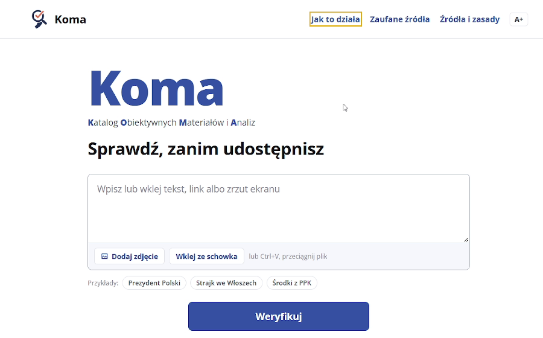
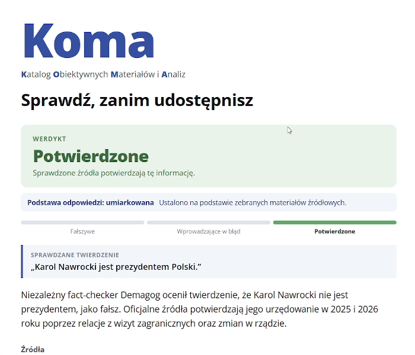
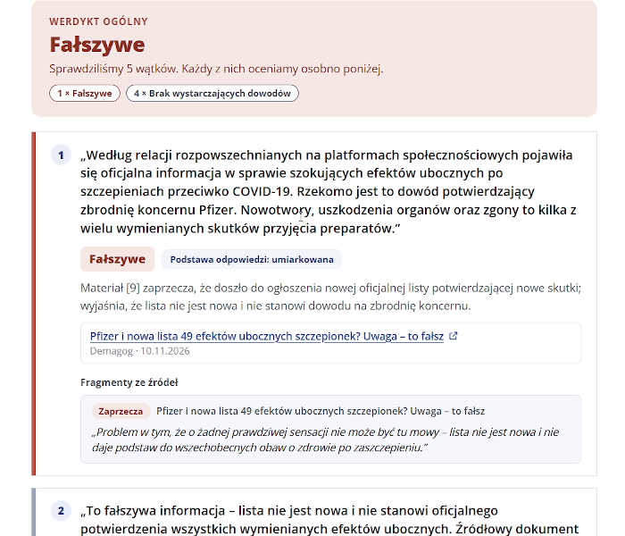
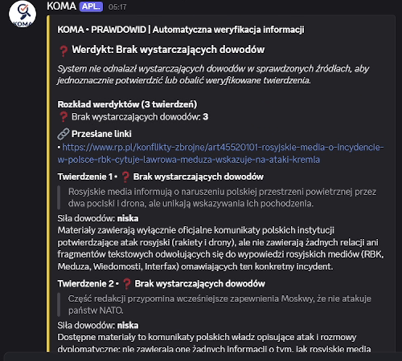
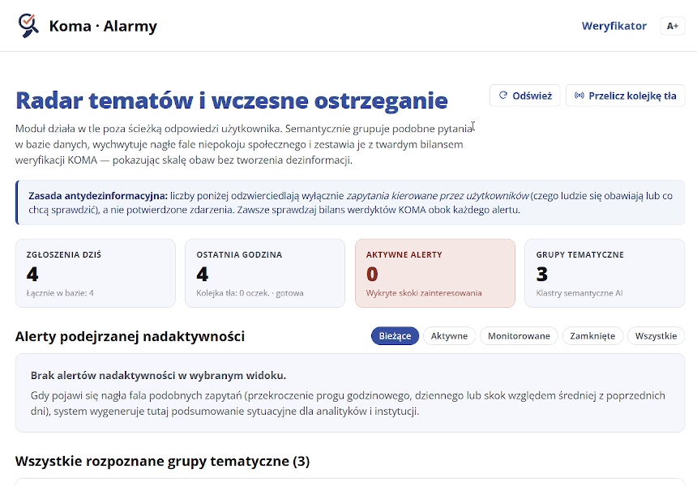

<p align="center"></p>
<h1 align="center">Koma</h1>
<p align="center"><b>K</b>atalog <b>O</b>biektywnych <b>M</b>ateriałów i <b>A</b>naliz · Sprawdź, zanim udostępnisz.<br>Zespół: <b>Drużyna</b> · HackNation 2026 · zadanie MSZ „Prawdowid”</p>

**Koma** sprawdza pogłoski, wiadomości, linki i zrzuty ekranu w oficjalnych źródłach państwowych i u niezależnych fact-checkerów. Dla każdego twierdzenia daje werdykt (*Potwierdzone, Fałszywe, Wprowadzające w błąd, Brak wystarczających dowodów, Nie podlega weryfikacji*) z uzasadnieniem i cytatami ze źródeł, a gdy dowodów brakuje — uczciwie się wstrzymuje.
Działa na stronie WWW, w rozszerzeniu przeglądarki, na Discordzie i w Messengerze. **Radar pytań** pokazuje analitykom, o co obywatele masowo pytają.

## 🎬 Film (3 min)

<p align="center">
  <a href="https://www.youtube.com/watch?v=hbNvKO5etng">
    
  </a>
</p>

## 🌐 Demo online

Modele AI działają lokalnie (Ollama), więc nie trzeba ich instalować — wystarczy otworzyć:

- **Weryfikator:** https://bird-seq-jonathan-vice.trycloudflare.com/
- **Radar pytań (panel analityka):** https://bird-seq-jonathan-vice.trycloudflare.com/alarmy
- **Zaufane źródła:** https://bird-seq-jonathan-vice.trycloudflare.com/#zrodla

## 📸 Jak to wygląda

| Strona | Werdykt ze źródłami |
|---|---|
|  |  |
| **Łańcuch dowodów (rozszerzenie)** | **Bot Discord** |
|  |  |

<p align="center"><b>Radar pytań</b><br></p>

## 💻 Uruchomienie u siebie

Wymagania: **Node.js 22+**, **[Ollama](https://ollama.com)** z modelami `qwen3.5:9b` i `glm-ocr:latest`, opcjonalnie klucz Google Fact Check Tools API.

```bash
git clone https://github.com/niepa04/prawdowid.git && cd prawdowid
ollama pull qwen3.5:9b && ollama pull glm-ocr:latest
npm install && npm install --prefix front-end
cp .env.example .env        # OLLAMA_URL, opcjonalnie GOOGLE_FACTCHECK_API_KEY
npm run build && npm start  # http://localhost:3000  (radar: /alarmy)
```

- **Rozszerzenie:** `chrome://extensions` → Tryb dewelopera → „Załaduj rozpakowane” → folder `extension/`.
- **Boty Discord / Messenger:** w `discord-bot/` lub `messenger-bot/` uzupełnij `.env`, potem `npm install && npm start` (Discord najpierw `npm run deploy`).

Pełna instrukcja: [docs/uruchomienie.md](docs/uruchomienie.md).

## 📖 Dokumentacja

[Opis projektu: kanały, architektura, źródła, testy, koszty i ryzyka](docs/opis_projektu.md) · [Architektura](docs/architektura.md) · [Werdykty i źródła](docs/werdykty_i_zrodla.md) · [API](docs/api.md) · [Bezpieczeństwo](docs/bezpieczenstwo.md) · [Konfiguracja](docs/konfiguracja.md) · [Testy](docs/testy.md)
