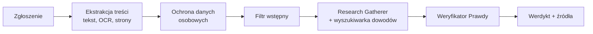

<p align="center">
  
</p>

<h1 align="center">Koma</h1>

<p align="center"><b>K</b>atalog <b>O</b>biektywnych <b>M</b>ateriałów i <b>A</b>naliz<br>
Sprawdź, zanim udostępnisz.</p>

---

Koma to narzędzie do weryfikacji informacji. Wklejasz tekst, link do artykułu albo zrzut ekranu,
a Koma sprawdza go w oficjalnych źródłach i u niezależnych fact-checkerów i odpowiada werdyktem
z uzasadnieniem i listą źródeł.

## Co potrafi

- **Tekst, linki i zrzuty ekranu** – z artykułów pobiera samą treść (bez menu i reklam), ze zdjęć czyta tekst (OCR).
- **Sprawdzanie w zaufanych źródłach** – 40 źródeł urzędowych (gov.pl, RCB, KPRM, MON, Policja, GIS, IMGW…)
  oraz oceny fact-checkerów (Demagog, Sprawdzam AFP, Konkret24, FakeNews.pl).
- **Werdykt dla każdej tezy** – Potwierdzone, Fałszywe, Wprowadzające w błąd, Brak wystarczających dowodów,
  Nie podlega weryfikacji – z cytatami ze źródeł.
- **Uczciwe „nie wiem”** – bez dowodów Koma mówi, że ich nie ma, zamiast zgadywać; przy awarii źródeł mówi,
  że teraz nie da się sprawdzić.
- **Ochrona prywatności** – zgłoszenia z danymi osobowymi (PESEL, adres, telefon, dane osób prywatnych)
  są blokowane, zanim trafią do analizy.
- **Rozszerzenie przeglądarki** – zaznacz tekst albo kliknij obrazek prawym przyciskiem → „Weryfikuj w Koma”.

## Jak to działa



Szczegóły: [docs/architektura.md](docs/architektura.md).

## Szybki start

Wymagania: Node.js 22+, serwer [Ollama](https://ollama.com) z modelami `qwen3.5:9b` i `glm-ocr:latest`.

```bash
npm install
npm install --prefix front-end
cp .env.example .env      # klucz Google Fact Check Tools API, adres Ollamy
npm run build             # buduje stronę
npm start                 # http://localhost:3000
```

Więcej: [docs/uruchomienie.md](docs/uruchomienie.md).

## Struktura projektu

| Folder | Zawartość |
|---|---|
| [`backend/`](backend) | serwer (Express) i kroki sprawdzania |
| [`config/`](config) | modele AI, prompty, zaufane źródła i domeny, limity |
| [`front-end/`](front-end) | strona Koma (React + Vite) |
| [`extension/`](extension) | rozszerzenie przeglądarki |
| [`tests/`](tests) | testy jakości werdyktów |
| [`docs/`](docs) | dokumentacja |

## Dokumentacja

- [Architektura](docs/architektura.md)
- [Konfiguracja](docs/konfiguracja.md)
- [Werdykty i źródła](docs/werdykty_i_zrodla.md)
- [API](docs/api.md)
- [Bezpieczeństwo i prywatność](docs/bezpieczenstwo.md)
- [Testy](docs/testy.md)

## Zespół

_Do uzupełnienia._

## Licencja

_Do uzupełnienia._
