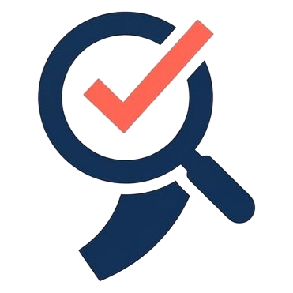

<p align="center"></p>
<h1 align="center">Koma</h1>
<p align="center"><b>K</b>atalog <b>O</b>biektywnych <b>M</b>ateriałów i <b>A</b>naliz · Sprawdź, zanim udostępnisz.<br>Zespół: <b>Drużyna</b> · HackNation 2026 · zadanie MSZ „Prawdowid”</p>

**Koma** to wielokanałowe narzędzie dla obywateli i analityków, które weryfikuje pogłoski, wiadomości tekstowe, linki do artykułów oraz zrzuty ekranu w oparciu o oficjalne źródła państwowe (40 instytucji `gov.pl` / służb) oraz korpusy niezależnych organizacji fact-checkingowych (standardy IFCN / EFCSN).

Dla każdego twierdzenia system zwraca jeden z 5 werdyktów (**Potwierdzone**, **Fałszywe**, **Wprowadzające w błąd**, **Brak wystarczających dowodów**, **Nie podlega weryfikacji**), krótkie uzasadnienie prostym językiem, ocenę siły dowodów oraz dosłowne cytaty ze źródeł (tytuł, wydawca, data publikacji, link). Gdy brakuje dowodów, system uczciwie wstrzymuje się od rozstrzygnięcia i rejestruje sprawę w pętli informacji. Awaria techniczna, brak klucza API, odrzucenie danych osobowych lub niejasne pytanie nigdy nie są prezentowane jako werdykt merytoryczny.

---

## 🌐 Działająca wersja demonstracyjna (Live Demo dla Jury)

> **Ważna informacja dla Jury:**  
> Ze względu na prywatność i niezależność od komercyjnych dostawców spoza EOG, Koma działa na **lokalnych modelach AI uruchamianych w Ollama** (`qwen3.5:9b` oraz `glm-ocr:latest`). **Nie chcemy, aby Jury musiało pobierać i instalować kilkunastu gigabajtów lokalnych modeli AI** na własnych komputerach — dlatego przygotowaliśmy działającą instancję połączoną z naszym serwerem modeli:
>
> - 👉 **Aplikacja główna (Weryfikator WWW):** **[https://bird-seq-jonathan-vice.trycloudflare.com/](https://bird-seq-jonathan-vice.trycloudflare.com/)**
> - 👉 **Panel analityczny i radar alertów (`/alarmy`):** **[https://bird-seq-jonathan-vice.trycloudflare.com/alarmy](https://bird-seq-jonathan-vice.trycloudflare.com/alarmy)**
> - 👉 **Katalog i zasady zaufanych źródeł (`#zrodla`):** **[https://bird-seq-jonathan-vice.trycloudflare.com/#zrodla](https://bird-seq-jonathan-vice.trycloudflare.com/#zrodla)**

*(Poniżej w sekcji [Pobranie i uruchomienie lokalne](#-pobranie-i-uruchomienie-lokalne) znajduje się również pełna instrukcja instalacji całego środowiska oraz wszystkich botów od zera).*

---

## 🤖 Kanały komunikacji, boty i moduły (co za co odpowiada)

Wszystkie kanały i boty są oddzielone od logiki weryfikacji i komunikują się z tym samym centralnym endpointem `POST /api/weryfikuj` (gwarancja 100% spójności wyniku merytorycznego niezależnie od kanału):

### 1. Interfejs WWW dla obywatela + Panel Analityczny (`front-end/` + `backend/`)
- **Dla obywatela (`/`)**: responsywna aplikacja React umożliwiająca wklejenie tekstu, linku lub zrzutu ekranu (przeciągnij i upuść / `Ctrl+V`). Posiada tryb wysokiego kontrastu i powiększonego tekstu (**A+**), syntezator mowy (**Odsłuchaj**), wizualną skalę werdyktu, dosłowne cytaty ze źródeł, eksport raportu do **JSON / CSV** oraz lokalną historię z przyciskiem **„Wyczyść sesję”**.
- **Dla moderatora i analityka (`/alarmy`)**: radar wczesnego ostrzegania przed kampaniami dezinformacyjnymi (FIMI). W asynchronicznej kolejce tła (SQLite + `qwen3.5:9b`) grupuje semantycznie podobne pytania napływające od użytkowników, wykrywa nagłe skoki zapytań (nadaktywność) i generuje podsumowania sytuacyjne wraz z bilansem werdyktów.

### 2. Bot Discord (`discord-bot/`)
- **Za co odpowiada:** umożliwia weryfikację informacji bezpośrednio na serwerach społecznościowych Discord za pomocą komend slash (`discord.js` v14), bez opuszczania komunikatora:
  - `/sprawdz [tekst] [linki] [zdjecie]` — przyjmuje tekst, jeden lub kilka linków URL oraz załącznik graficzny (PNG, JPG, WEBP, GIF, BMP do 5 MB, który pobiera i przekazuje do OCR w Koma). Zwraca pokolorowane karty (`Embeds`) z werdyktem ogólnym, oceną poszczególnych wątków/tez, siłą podstawy dowodowej, cytatami i klikalnymi źródłami.
  - `/status` — sprawdza w czasie rzeczywistym dostępność serwera Koma, liczbę aktywnych źródeł urzędowych oraz stan kolejki monitoringu.
  - `/pomoc` — wyświetla zwięzłą instrukcję obsługi bota i objaśnienie 5 możliwych werdyktów.

### 3. Bot Facebook Messenger (`messenger-bot/`)
- **Za co odpowiada:** pełny serwis integracyjny z **Meta Messenger Platform (Graph API v21.0)** działający jako webhook (`POST /webhook`):
  - Odbiera wiadomości prywatne wysyłane do strony na Messengerze — obsługuje zwykły tekst, wklejone linki oraz przesłane zdjęcia/zrzuty ekranu (pobierane z załączników Messengera i zamieniane na Base64 do analizy OCR).
  - Weryfikuje autentyczność każdego żądania z Meta podpisem kryptograficznym HMAC-SHA256 (`X-Hub-Signature-256` z `META_APP_SECRET`), chroni przed duplikatami zdarzeń (`mid` cache) oraz wysyła wskaźnik pisania (`typing_on`).
  - Formatuje odpowiedź z `/api/weryfikuj` na czytelny komunikat czatu (z ikoną werdyktu, uzasadnieniem, szczegółowymi tezami i listą źródeł) i automatycznie dzieli dłuższe analizy na części zgodne z limitem 2 000 znaków Messengera.
  - Udostępnia stronę polityki prywatności (`GET /privacy`) wymaganą przez Meta Developer Portal oraz endpoint kontrolny (`GET /health`).

### 4. Rozszerzenie przeglądarki Chrome / Edge (`extension/`)
- **Za co odpowiada:** wtyczka w standardzie Manifest V3 pozwalająca sprawdzić informację jednym kliknięciem bezpośrednio na czytanym portalu lub w mediach społecznościowych:
  - Po zaznaczeniu dowolnego tekstu na stronie lub kliknięciu prawym przyciskiem myszy na obrazek pojawia się opcja **„Weryfikuj w Koma”**.
  - Nie wstrzykuje skryptów śledzących i nie czyta stron w tle — pobiera wyłącznie zaznaczony przez użytkownika fragment (zasada minimalizacji danych). Moze łączyć się z serwerem lokalnym (`localhost:3000`) lub adresem demonstracyjnym.

### 5. Detektor obrazów wygenerowanych przez AI (`ai-image-detector/`)
- **Za co odpowiada:** osobny mikroserwis HTTP (`POST /api/detect-ai`) wykrywający deepfake'i i grafiki wygenerowane przez modele dyfuzyjne/GAN:
  - Wykorzystuje model wizyjny `abacusai/Smaug-AI-Image-Detector-GGUF:Q8_0` (uruchamiany przez `llama-server` z projektorem multimodalnym `--mmproj`) oraz wyuczoną głowicę klasyfikacyjną (`head.json`).
  - Analizuje obraz w kilku kadrach (`crops`) i zwraca prawdopodobieństwo (`ai_probability`, `ai_percent`, `human_percent`) wygenerowania obrazu przez AI.

---

## 🏗️ Architektura i przepływ danych

```text
Zgłoszenie (WWW / Discord / Messenger / Rozszerzenie)
  │
  ▼
1. Ekstrakcja treści (backend/ekstrakcja/)
   ├─ wyodrębnienie tekstu, pobranie czystej treści artykułów z linków (webscraper + ochrona SSRF)
   ├─ odczyt tekstu ze zdjęć i zrzutów ekranu (lokalny model OCR: glm-ocr:latest)
   └─ odfiltrowanie szumu z linków/zdjęć pod kątem pytania użytkownika (qwen3.5:9b)
  │
  ▼
2. Ochrona danych osobowych (backend/ochrona_danych/)
   └─ deterministyczne wykrywanie PESEL, dowodów, paszportów, IBAN, kart (sumy kontrolne),
      telefonów, e-maili i adresów -> blokada w tekście/zdjęciach użytkownika, maskowanie w linkach
  │
  ▼
3. Filtr wstępny (backend/filtr_wstepny/) + Równoległe planowanie researchu
   └─ odrzucenie spamu, bełkotu, samych poleceń (prompt injection) oraz danych osób prywatnych
  │
  ▼
4. Research Gatherer + Wyszukiwarka Dowodów (backend/research/ + backend/wyszukiwarka_dowodow/)
   ├─ dobór źródeł z katalogu 40 instytucji rządowych i służb (gov.pl, RSO, RCB, MSZ Odyseusz,
   │  MON, MSWiA, Policja, PSP, GIS, GIOŚ, PAA, CERT Polska, IMGW, GDDKiA, ULC, UTK i in.)
   ├─ odpytanie Google Fact Check Tools API (Demagog, Sprawdzam AFP, Konkret24, FakeNews.pl)
   │  wieloma kombinacjami słów kluczowych i odmian + pełnotekstowa analiza artykułów Demagoga
   └─ synteza notatki badawczej z przypisami [nr] i listą luk informacyjnych
  │
  ▼
5. Weryfikator Prawdy (backend/weryfikator/) + Pętla informacji
   ├─ wyodrębnienie dosłownych tez ze zgłoszenia użytkownika
   ├─ twarda walidacja w kodzie: każdy dowód musi zawierać dosłowny cytat z pobranego materiału,
   │  a daty, godziny i liczby są weryfikowane krzyżowo
   ├─ zapis nierozstrzygniętych spraw z deduplikacją (backend/dane/nierozstrzygniete.json)
   └─ asynchroniczny zapis zanonimizowanego zgłoszenia do radaru trendów (monitoring.sqlite)
```

---

## 📥 Pobranie i uruchomienie lokalne

Jeśli chcesz uruchomić system lokalnie na własnym komputerze lub serwerze:

### Wymagania
- **Node.js 22+** (wbudowana obsługa `fetch` oraz `node:sqlite`)
- **Ollama** ([https://ollama.com](https://ollama.com)) z pobranymi dwoma modelami lokalnymi (lub podpięcie pod zdalny serwer Ollama przez `OLLAMA_URL`)
- *(Opcjonalnie)* klucz `GOOGLE_FACTCHECK_API_KEY` do publicznego API ocen fact-checkerów

### Krok 1: Pobranie repozytorium i modeli AI (Ollama)

```bash
git clone https://github.com/niepa04/prawdowid.git
cd prawdowid

# Pobranie lokalnych modeli w Ollama (możesz pominąć, jeśli wskazujesz zdalny OLLAMA_URL w .env)
ollama pull qwen3.5:9b
ollama pull glm-ocr:latest
```

### Krok 2: Instalacja i uruchomienie głównego serwera Koma (WWW + API)

```bash
npm install
npm install --prefix front-end

cp .env.example .env
# W pliku .env ustaw OLLAMA_URL (domyślnie http://localhost:11434)
# oraz opcjonalnie GOOGLE_FACTCHECK_API_KEY

npm run build
npm start
```
Serwer oraz interfejs WWW będą dostępne pod adresem **`http://localhost:3000`** (panel analityczny: **`http://localhost:3000/alarmy`**).

### Krok 3: Uruchomienie bota Discord (`discord-bot/`)

```bash
cd discord-bot
npm install
cp .env.example .env
# Uzupełnij w discord-bot/.env:
# DISCORD_TOKEN=<token_bota>
# CLIENT_ID=<id_aplikacji_discord>
# GUILD_ID=<id_serwera_discord>
# KOMA_API_URL=http://localhost:3000  (lub https://bird-seq-jonathan-vice.trycloudflare.com)

npm run deploy    # jednorazowa rejestracja komend slash (/sprawdz, /status, /pomoc)
npm start         # uruchomienie bota
```

### Krok 4: Uruchomienie bota Facebook Messenger (`messenger-bot/`)

```bash
cd messenger-bot
npm install
cp .env.example .env
# Uzupełnij w messenger-bot/.env:
# PORT=3001
# KOMA_API_URL=http://localhost:3000  (lub https://bird-seq-jonathan-vice.trycloudflare.com)
# VERIFY_TOKEN=<własny_token_weryfikacyjny>
# PAGE_ACCESS_TOKEN=<token_strony_z_Meta_Developer_Portal>
# META_APP_SECRET=<app_secret_do_weryfikacji_HMAC>
# PAGE_ID=<id_strony_FB>

npm start
```
Szczegółowa instrukcja podpięcia webhooka przez Cloudflare Tunnel do Meta Developer Portal znajduje się w [messenger-bot/MESSENGER_SETUP.md](messenger-bot/MESSENGER_SETUP.md).

### Krok 5: Instalacja rozszerzenia przeglądarki (`extension/`)

1. Otwórz w Chrome `chrome://extensions` (lub w Edge `edge://extensions`) i włącz **Tryb dewelopera**.
2. Kliknij **Załaduj rozpakowane** i wskaż folder `extension/`.
3. Kliknij ikonę rozszerzenia Koma na pasku przeglądarki, aby wybrać adres serwera (`http://localhost:3000` lub `https://bird-seq-jonathan-vice.trycloudflare.com`).
4. Zaznacz tekst na dowolnej stronie lub kliknij obrazek prawym przyciskiem myszy → **„Weryfikuj w Koma”**.

### Krok 6: Uruchomienie detektora obrazów AI (`ai-image-detector/` – opcjonalnie)

```bash
cd ai-image-detector
npm install
cp .env.example .env
npm start   # http://localhost:4000 (wymaga llama-server z modelem Smaug-AI-Image-Detector-GGUF)
```
Szczegóły uruchomienia `llama-server`: [ai-image-detector/README.md](ai-image-detector/README.md).

---

## 📚 Źródła, licencje, kwalifikacja i aktualizacja

Koma nie traktuje internetu jako otwartego korpusu i nie pozwala modelowi językowemu zgadywać faktów z pamięci parametrycznej. Wykorzystuje dwa typy zweryfikowanych źródeł (jawnie opisanych w [`config/zrodla/`](config/zrodla)):

1. **Źródła pierwotne i urzędowe (40 źródeł z kilkunastu domen instytucjonalnych)** – m.in. `gov.pl` (RSO, KPRM, RCB, MON, MSWiA, GIS, PAA, Ministerstwo Infrastruktury, Wody Polskie, MSZ), `odyseusz.gov.pl`, `policja.pl`, `mazowiecka.policja.gov.pl`, `monitoring.paa.gov.pl`, `powietrze.gios.gov.pl`, `moje.cert.pl`, `drogi.gddkia.gov.pl`, `ulc.gov.pl`, `portalpasazera.pl`, `utk.gov.pl`, `kgsok.pl`, `sar.gov.pl`, `umgdy.gov.pl`, `ums.gov.pl`, `meteo.imgw.pl`, `hydro.imgw.pl`, `baltyk.imgw.pl`.
   - **Licencja:** informacja sektora publicznego udostępniana do ponownego wykorzystywania zgodnie z ustawą z dnia 11 sierpnia 2021 r. o otwartych danych i ponownym wykorzystywaniu informacji sektora publicznego (Dz.U. 2021 poz. 1641).
2. **Wiarygodne źródła wtórne – korpusy fact-checkingowe (IFCN / EFCSN)** – publiczne API **Google Fact Check Tools** (standard `ClaimReview`) filtrowane ściśle do 4 polskich redakcji: **Demagog** (`demagog.org.pl`), **Sprawdzam AFP** (`sprawdzam.afp.com`), **Konkret24** (`konkret24.tvn24.pl`), **FakeNews.pl** (`fakenews.pl`), wraz z pełnym odczytem artykułów źródłowych Demagoga.
   - **Licencja:** otwarte metadane `ClaimReview` (publiczne API Google Fact Check Tools) oraz krótkie fragmenty dokumentacyjne przytaczane na zasadzie prawa cytatu (art. 29 ustawy o prawie autorskim i prawach pokrewnych) z obowiązkowym podaniem tytułu, wydawcy, daty i bezpośredniego linku do artykułu źródłowego.
3. **Kwalifikacja, aktualizacja i wykluczanie źródeł:**
   - Każde źródło przed dodaniem do `config/zrodla/zrodla_oficjalne.json` przechodzi audyt według 8 kryteriów z `config/zrodla/kryteria_zrodel.json` (status instytucji/sygnatariusza IFCN lub EFCSN, oficjalna domena z HTTPS, jawny wydawca, datowane publikacje, dostępność bez obchodzenia zabezpieczeń antybotowych, neutralność).
   - Dodanie lub wykluczenie źródła nie wymaga zmian w kodzie — odbywa się przez edycję pliku JSON (`"enabled": true/false`). Tylko aktywne hosty z rejestru są przepuszczane przez zaporę SSRF.

---

## 🧪 Testy i wyniki walidacji (Sekcja 6)

- **Testy jednostkowe (65 testów, bez potrzeby uruchamiania modeli AI):**
  ```bash
  npm test
  ```
  Obejmują też testy bota Messenger (`cd messenger-bot && npm test`) oraz detektora AI (`cd ai-image-detector && npm test`).

- **Testy jakości werdyktów i mierników obowiązkowych MVP:**
  ```bash
  node tests/test_werdyktow.js --szybki          # szybka próba przekrojowa (~5 min)
  node tests/test_werdyktow.js                   # pełny zestaw: 100 zgłoszeń (20 tematów × 5 sformułowań) + ataki + kanały
  ```
  Wyniki z ostatniej próby walidacyjnej:
  - **Mediana czasu odpowiedzi (tekst):** **26,5 s** (cel MVP: $\le 30\text{ s}$)
  - **Pokrycie cytowań:** **100%** (cel MVP: $\ge 95\%$)
  - **Odporność na prompt injection:** **100%** (cel MVP: $\ge 90\%$)
  - **Działanie end-to-end (bez ingerencji twórców):** **100%**
  - **Spójność międzykanałowa:** **100%**
  - **Pętla informacji (deduplikacja spraw):** **100%**
  - **Zużycie zasobów na 1 zapytanie:** średnio **2,9 wywołania LLM**, ok. **6,3 tys. tokenów**

---

## 💰 Koszt, miejsce przetwarzania danych i zachowanie przy dużym ruchu

- **Miejsce przetwarzania danych (suwerenność cyfrowa / EOG):** wszystkie modele językowe i OCR (`qwen3.5:9b`, `glm-ocr:latest`) oraz baza SQLite działają **lokalnie na własnej infrastrukturze zespołu (self-hosted w EOG)**. Treść zgłoszeń użytkowników nigdy nie jest wysyłana do komercyjnych dostawców LLM (OpenAI, Anthropic itp.).
- **Szacowany koszt 1 000 zapytań: ok. 10–40 zł** (0 zł opłat licencyjnych za API LLM; koszt odpowiada ok. 8 godzinom pracy karty GPU przy ~25–30 s na zapytanie — prąd własnego serwera lub wynajem instancji GPU w chmurze europejskiej). Google Fact Check Tools API jest bezpłatne. Dla obywatela usługa jest w 100% bezpłatna.
- **Zachowanie przy zwiększonym ruchu:** pojedyncza instancja Ollama obsługuje ok. 100–150 zapytań na godzinę (zapytania są kolejkowane). Monitoring trendów i grupowanie AI działają w asynchronicznej kolejce tła i są automatycznie wstrzymywane, gdy trwa weryfikacja dla użytkownika. Po przekroczeniu limitu czasu (`MAX_CZAS_SPRAWDZENIA_MS`) użytkownik otrzymuje jasny status techniczny `503/504` („Nie można teraz sprawdzić”), a nigdy fałszywy werdykt. Skalowanie poziome polega na dołożeniu instancji Ollama za load balancerem oraz włączeniu cache'owania powtarzających się zapytań z bazy klastrów.

---

## ⚠️ Najważniejsze ryzyka i ograniczenia

| Ryzyko | Zastosowane zabezpieczenie / ograniczenie |
|---|---|
| **Halucynacje modelu** | Model nie może wydać werdyktu z własnej pamięci. Reguły w kodzie (`weryfikatorPrawdy.js`, `evidenceMatcher.js`) wymuszają dosłowny cytat obecny w pobranym materiale oraz zgodność dat, godzin i liczb. Brak dowodu w tekście źródła automatycznie wymusza werdykt *„Brak wystarczających dowodów”*. |
| **Stronniczość źródeł** | Łączenie źródeł pierwotnych (komunikaty i pomiary urzędowe) z wieloma niezależnymi redakcjami fact-checkingowymi (IFCN/EFCSN). Sama domena ani link z zaufanego źródła nie przesądzają o werdykcie — system wyklucza link z zapytania użytkownika i szuka niezależnych potwierdzeń. |
| **Prywatność i RODO** | Deterministyczny filtr (`daneOsobowe.js`: PESEL, dokumenty, IBAN, karty płatnicze, telefony, e-maile, adresy) oraz klasyfikator danych osób prywatnych blokują zgłoszenie **zanim** trafi ono do wyszukiwarki lub bazy SQLite. Możliwość usunięcia historii sesji jednym kliknięciem. |
| **Prompt injection** | Ścisła separacja promptów systemowych od danych (losowe separatory kryptograficzne w filtrze tematu), skanowanie pobranych stron pod kątem instrukcji sterujących (`security_flags`), brak wykonywania kodu/narzędzi przez LLM oraz weryfikacja, że wyodrębniona teza i cytaty są podciągami tekstu wejściowego/źródłowego. |
| **Dostępność i awarie** | Rozdzielenie błędów technicznych (`status: "unavailable"`, werdykt techniczny *„Nie można teraz sprawdzić”*) od braku dowodów. Zabezpieczenia WAF/Cloudflare/CAPTCHA stron źródłowych nie są obchodzone — niedostępność źródła jest jawnie raportowana. |
| **Nadużycia i SSRF** | Filtr antyspamowy i tematyczny na wejściu; blokada adresów lokalnych, prywatnych sieci IP (w tym Tailscale `100.64.0.0/10`) i przekierowań poza zatwierdzone domeny (`sourceFetcher.js`, `webscraper.js`). |

**Znane ograniczenia:** prototyp weryfikuje obrazy poprzez OCR tekstu oraz detekcję AI (`ai-image-detector`), ale nie wykonuje pełnego odwrotnego wyszukiwania obrazu (reverse image search) w płatnych indeksach zewnętrznych ani transkrypcji nagrań wideo (zgłoszenie wideo zwraca jawny kod `501`).

---

## 📖 Szczegółowa dokumentacja (`docs/`)

- [Architektura i przepływ danych](docs/architektura.md)
- [Instrukcja uruchomienia](docs/uruchomienie.md)
- [Konfiguracja modeli, promptów i źródeł](docs/konfiguracja.md)
- [Zasady werdyktów i kwalifikacji źródeł](docs/werdykty_i_zrodla.md)
- [Specyfikacja API HTTP](docs/api.md)
- [Bezpieczeństwo i ochrona prywatności](docs/bezpieczenstwo.md)
- [Instrukcja testów i mierników](docs/testy.md)
