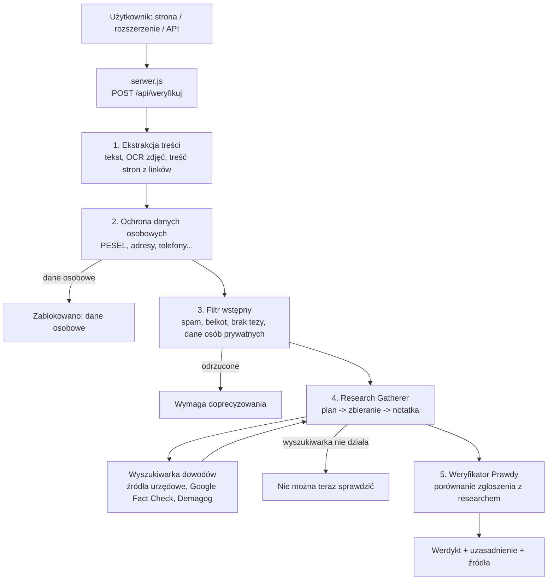

# Architektura

Koma przyjmuje zgłoszenie (tekst, link do artykułu, zrzut ekranu) i odpowiada werdyktem z uzasadnieniem
i listą źródeł. Całość działa na jednym serwerze Node.js (Express), a modele AI na serwerze Ollama.

## Przepływ sprawdzania



| Krok | Folder | Co robi | Model AI |
|---|---|---|---|
| 1. Ekstrakcja treści | `backend/ekstrakcja/` | Rozdziela tekst, linki i zdjęcia. Zdjęcia czyta OCR, z linków pobiera samą treść artykułu (bez menu i stopek). Jeśli jest tekst użytkownika, model zostawia z treści stron i zdjęć tylko to, co dotyczy tematu. | `ocr`, `filtr` |
| 2. Ochrona danych osobowych | `backend/ochrona_danych/` | Wykrywa dane osobowe regułami z sumami kontrolnymi. W tekście i na zdjęciach blokuje zgłoszenie, ze stron z linków wycina dane. | – |
| 3. Filtr wstępny | `backend/filtr_wstepny/` | Odrzuca spam, bełkot, small talk, same polecenia dla systemu i dane osób prywatnych, których nie złapały reguły. | `filtr` |
| 4. Research Gatherer | `backend/research/` | Planuje research (jedno pytanie badawcze na tezę użytkownika i słowa kluczowe z odmianami), zbiera materiały przez wyszukiwarkę dowodów i pisze notatkę z numerami źródeł. | `analiza` |
| – Wyszukiwarka dowodów | `backend/wyszukiwarka_dowodow/` | Przeszukuje katalog zaufanych źródeł, bazę ocen fact-checkerów (Google Fact Check Tools) i artykuły Demagoga. Nie wydaje werdyktów. | – |
| 5. Weryfikator Prawdy | `backend/weryfikator/` | Porównuje całe zgłoszenie z notatką i materiałami, wskazuje tezy (cytaty słowo w słowo) i wydaje werdykt każdej z nich. Kod pilnuje twardych zasad (patrz [Werdykty i źródła](werdykty_i_zrodla.md)). | `analiza` |

Orkiestracja: `backend/pipeline.js`. Serwer HTTP: `backend/serwer.js`.

## Struktura projektu

```
.
├── backend/                    serwer i logika sprawdzania (Node.js, Express)
│   ├── serwer.js               serwer HTTP: strona, /api/weryfikuj, /api/status
│   ├── pipeline.js             kolejność kroków sprawdzania
│   ├── ekstrakcja/             1. tekst, OCR, treść stron (webscraper)
│   ├── ochrona_danych/         2. filtr danych osobowych
│   ├── filtr_wstepny/          3. filtr wstępny
│   ├── research/               4. Research Gatherer
│   ├── wyszukiwarka_dowodow/   wyszukiwanie dowodów w źródłach i u fact-checkerów
│   ├── weryfikator/            5. Weryfikator Prawdy
│   ├── wspolne/                wywołanie modelu (Ollama), walidacja wejścia, rejestr nierozstrzygniętych
│   └── dane/                   dane robocze (nie w repozytorium)
├── config/                     wszystko, co wymienne: modele, prompty, źródła, limity
├── front-end/                  strona Koma (React + Vite)
├── extension/                  rozszerzenie przeglądarki (Chrome / Edge)
├── tests/                      testy jakości werdyktów (mierniki)
└── docs/                       dokumentacja
```

## Odpowiedź serwera

Wszystkie kroki zwracają odpowiedź w tym samym kształcie (`status`, `werdykt_ogolny`, `demagog.twierdzenia`,
`research`, `metadane`), więc strona i rozszerzenie obsługują jednakowo pełny werdykt, odrzucenie przez
filtr i awarię wyszukiwania. Szczegóły: [API](api.md).

> Pole z werdyktami nazywa się `demagog` z powodów historycznych (pierwsza wersja modułu werdyktów).
> Zawiera wynik Weryfikatora Prawdy.

## Pętla informacji i monitoring trendów w tle

Sprawy, których nie udało się rozstrzygnąć („Brak wystarczających dowodów”), trafiają do rejestru
`backend/dane/nierozstrzygniete.json` (bez duplikatów). To lista tematów, dla których warto dodać źródła.
Zgłoszenia zablokowane (dane osobowe) i przy awarii wyszukiwania do rejestru nie trafiają.

Równolegle działa komponent monitoringu (`backend/monitoring_promptow/`), który:
- zapisuje w bazie SQLite (`backend/dane/monitoring.sqlite`) wyłącznie zanonimizowane zgłoszenia po przejściu filtrów prywatności i antyspamowych (dane osobowe nigdy nie trafiają do bazy),
- w asynchronicznej kolejce tła (poza ścieżką odpowiedzi HTTP użytkownika) grupuje semantycznie różne sformułowania dotyczące tego samego tematu przy użyciu modelu `qwen3.5:9b` (z szybką ścieżką hash dla powtórzeń i trybem awaryjnym),
- wykrywa podejrzaną nadaktywność i przygotowuje antydezinformacyjne podsumowanie sytuacyjne (dla użytkowników i instytucji publicznych) oparte wyłącznie na twardych liczbach z bazy i bilansie werdyktów KOMA.
